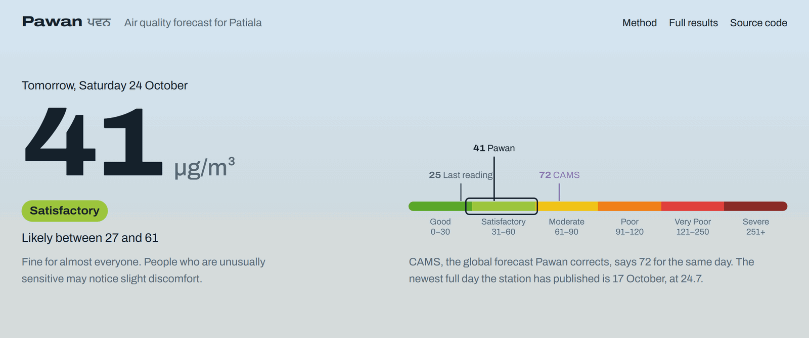

# Pawan: next-day air quality forecasting for Patiala

Pawan forecasts tomorrow's daily mean PM2.5 at the CPCB station in
Model Town, Patiala, every day without anyone running it, and the
two days after that with a wider range. It takes the CAMS global
forecast, which overshoots badly at this station, and corrects it
using the station's own freshest reading, forecast weather and
satellite fire detections upwind.

[](https://github.com/Blakkbird/ucs503p-202627odd-Project-P1.v1/actions/workflows/ci.yml)
[](https://github.com/Blakkbird/ucs503p-202627odd-Project-P1.v1/actions/workflows/ingest.yml)
[](https://blakkbird.github.io/ucs503p-202627odd-Project-P1.v1/results/)

**[Live dashboard](https://blakkbird.github.io/ucs503p-202627odd-Project-P1.v1/dashboard/)** ·
**[Tomorrow's forecast](https://blakkbird.github.io/ucs503p-202627odd-Project-P1.v1/forecast/)** ·
**[Results](https://blakkbird.github.io/ucs503p-202627odd-Project-P1.v1/results/)** ·
**[Project page](https://blakkbird.github.io/ucs503p-202627odd-Project-P1.v1/)** ·
[Proposal](project-proposal/main.pdf) ·
[Prototype report](project-report-prototype-stage/main.pdf)

UCS503P Software Engineering, TIET Patiala, 2026-27 odd semester.
Instructor: Dr. Paramveer Kaur.

[](https://blakkbird.github.io/ucs503p-202627odd-Project-P1.v1/dashboard/)

The dashboard shows:

- **Tomorrow's number:** on the CPCB scale next to the raw CAMS
  figure it corrects, with the two days after it.
- **The fires:** a map of yesterday's fires with tomorrow's wind
  laid over them.
- **What drives the forecast:** an exact breakdown of what pushed
  it up or down, sliders to try other inputs, and the past days
  that looked most like tomorrow.
- **Every model:** the whole model lab, scored on the same days.
- **Reading age and range:** how the error grows as the station
  reading gets older, and how often the likely range holds.
- **The record:** the full history against the backtest, and
  whether the pipeline ran today.

It is rebuilt from `data/` on every run.

## Where it stands

Walk-forward backtest, April 2025 to November 2026, mean absolute
error in µg/m³. Each forecast uses the freshest station reading
that had been published in time, two days old at the reference
age, and persistence repeats that same reading. Skill is the
reduction in error against it.

| | Days | Pawan | Persistence | Raw CAMS | Skill | Target |
| --- | ---: | ---: | ---: | ---: | ---: | ---: |
| Calm season | 394 | 7.98 | 9.19 | 44.02 | +13.2% | 10% |
| Burning season (Oct, Nov) | 76 | 12.85 | 15.84 | 32.85 | +18.9% | 20% |
| Live forecasts only | 60 | 7.32 | 9.03 | 42.39 | +18.9% | |

Snapshot from 3 November 2026. The [results page](https://blakkbird.github.io/ucs503p-202627odd-Project-P1.v1/results/)
is regenerated every day and is the current one.

With readings four days old, the situation the proposal was
written for, the same backtest gives +21.6% in calm season and
+31.8% in burning season. Since late October the feed has been
fast enough to give two-day-old readings. Against persistence
given the same reading, the calm target is met and the burning
target is a point short: the faster feed made the baseline better
by more than it made the model better.

What it does not do yet is see pollution spikes coming. On those
days the dashboard's list of the most similar past days is the
plainest warning sign.

## How it works

Every day a GitHub Actions job runs the whole pipeline. It is
scheduled for 08:00 IST, but GitHub starts scheduled jobs late, so
it usually runs in the afternoon, and each forecast records when it
was issued. Four backup runs through the day step in only if that
run went out without a forecast, or if by evening it has not run at
all. The job:

1. fetches the last 30 days of station readings (OpenAQ), the next
   three days of CAMS and weather forecasts (Open-Meteo), and fire
   detections (NASA FIRMS), and appends them to `data/daily.csv`;
2. finds the freshest valid station reading on file, refits the
   model at that reading's age, and re-runs the walk-forward
   backtest (`code/evaluate.py`);
3. issues tomorrow's forecast and the two days after it, and
   freezes them (`code/predict.py`);
4. runs the model lab: each candidate model's forecast for
   tomorrow, frozen beside the real one, and once a week the full
   leaderboard (`code/lab.py`);
5. posts the forecast to a Telegram channel (`code/notify.py`);
6. rebuilds the forecast and results pages, and the dashboard's
   data file, from the data (`code/pages.py`);
7. runs the full test suite, and only then commits.

There is no server and no database. The dataset is a CSV in git, so
its history is the commit log, and every number on the site is
generated from it. The forecast that ships is a ridge regression in
log space, written out by hand and standard library only. Why it is
built this way is in [Method](docs/method.md); what is in the table
and where it comes from is in [Data](docs/data.md). The requirements,
UML diagrams and design decisions are in [Design](docs/design.md).

## The model lab

`code/lab.py` scores the shipped model against eleven others on the
same days and with the same information:

- **Baselines:** persistence, climatology and raw CAMS.
- **Simple corrections:** CAMS rescaled by its recent ratio to the
  station, ridge with burning-season smoke terms, ridge corrected
  by its own errors over the past week, and analog days.
- **Benchmarks:** a random forest, gradient boosting and a small
  neural network, plus an ensemble.

It also scores the shipped model at every reading age from two to
seven days. A challenger replaces the shipped model only by passing
a rule written in the code, which checks burning season, calm
season, older readings and its own live record. So far ridge holds:
on about five hundred days it beats the forest, the boosting and the
network. The smoke terms look better at two-day-old readings but
break down at older ones. The recent-error correction is the best
single model overall and the only one ahead of persistence in the
smoky first half of November 2026, but its gain across both burning
seasons is short of the bar, so it is being scored live first.

## API

A small FastAPI service serves the same data to programs, and runs
the model on inputs you supply:

```shell
pip install -r requirements-api.txt
python code/api.py                   # docs at http://127.0.0.1:8000/docs
```

`/forecast`, `/forecasts`, `/models` and `/health` read the data
files; `/whatif` runs the shipped model and flags any input outside
the range it was fitted on. Given 16 November's real inputs it
returns the forecast the daily job issued, to the hundredth. The
website does not depend on it. Details in [API](docs/api.md).

## Daily alerts

The daily job posts the forecast to a Telegram channel, with a
warning line when the band is Poor or worse and a plain note when no
forecast could be issued. It needs two repository secrets,
`TELEGRAM_BOT_TOKEN` and `TELEGRAM_CHAT_ID` (the channel's
`@name`); without them it prints the post instead. Each forecast is
posted once however many times the job runs, and no error message
ever carries the token.

## Layout

```
code/
  config.py          every setting, in one place
  ingest/            the daily job: observations, forecasts, fires
  features.py        daily.csv -> model rows, at a stated reading age
  model.py           ridge regression, by hand
  evaluate.py        baselines, the walk-forward backtest, the range
  predict.py         tomorrow and the outlook, issued once and frozen
  candidates.py      every model on the leaderboard, one interface
  lab.py             the model lab: leaderboard, ages, shadow runs
  notify.py          the daily Telegram post
  api.py             the HTTP API (FastAPI)
  due.py             whether a backup run has work to do
  pages.py           forecast.md, results.md and the dashboard's data
  tests/             run on every PR and every data commit
scripts/
  extend_history.py  pulls the record back to the sensor's start
  backfill_history.py  weather and fire counts for archive rows
  compare_models.py  the week 7 comparison, kept as it was run
  report_figures.py  every number in the prototype report
data/                daily.csv and the files derived from it
docs/                the project page (MkDocs)
docs/dashboard/      the live dashboard: hand-written page, generated data.json
journals/            weekly entries, one folder per member
project-proposal/              LaTeX, week 4
project-report-prototype-stage/  LaTeX, week 7
project-report-final/          LaTeX, week 17
```

## Running it

```shell
pip install -r requirements.txt
python code/ingest/run_daily.py      # needs OPENAQ_KEY and FIRMS_MAP_KEY
python code/evaluate.py              # backtest; writes metrics and model
python code/predict.py               # tomorrow's forecast and the outlook
pip install -r requirements-lab.txt  # only for the lab's benchmarks
python code/lab.py                   # shadow forecasts; weekly leaderboard
python code/notify.py                # prints the post when no secrets are set
python code/pages.py                 # the pages and the dashboard's data
python -m pytest code/tests/ -q
```

Keys can go in a `.env` file at the root; it is gitignored. The
forecast needs nothing outside the standard library, on purpose:
the daily job has to keep running unattended, and the less it
depends on, the less can change underneath it.

- `requirements.txt`: `pytest` and `ruff`.
- `requirements-lab.txt`: scikit-learn, for the lab's benchmarks,
  which run in a step of their own that cannot stop the daily commit.
- `requirements-api.txt`: FastAPI and uvicorn, for the API only.
- `requirements-docs.txt`: the site's toolchain, pinned below
  MkDocs 2.0.

To rebuild the prototype report:

```shell
python scripts/report_figures.py
cd project-report-prototype-stage
latexmk -pdf main.tex
```

## Workflows

| Workflow | When | What |
| --- | --- | --- |
| CI | every PR and push to `master` | `ruff` and `pytest`, with the lab's requirements |
| Daily ingest | scheduled 08:00 IST, usually runs in the afternoon; four backups through the day work only if no forecast went out | the seven steps above, then commit |
| mkdocs | every push to `master` | build and deploy the project page |
| Extend history | by hand, dry run by default | one-off history extension |

`master` is protected. Changes go through pull requests.

## Team

| | Roll No |
| --- | --- |
| Gurkirpa Singh | 1024170378 |
| Ketubh Bansal | 1024170399 |
| Aayush Kandhol | 1024170379 |

Forked from the course template,
[tiet-ucs503/ucs503p-202627odd-template](https://github.com/tiet-ucs503/ucs503p-202627odd-template).
