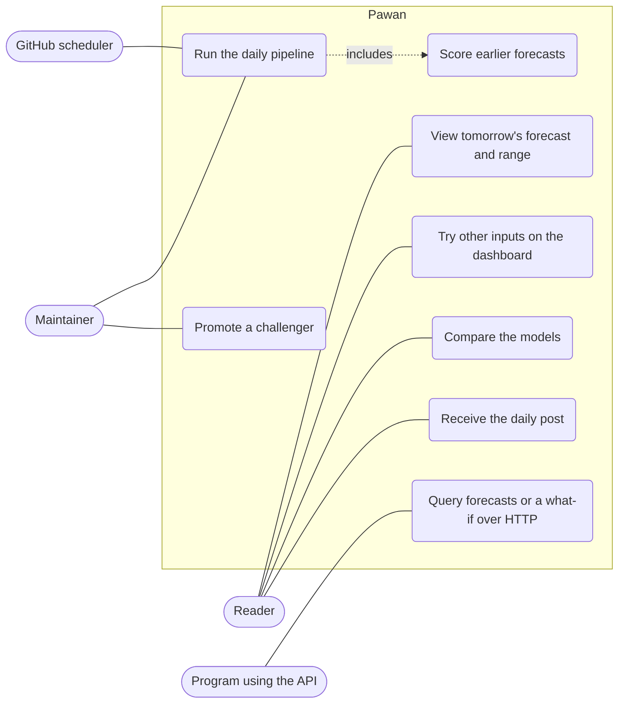
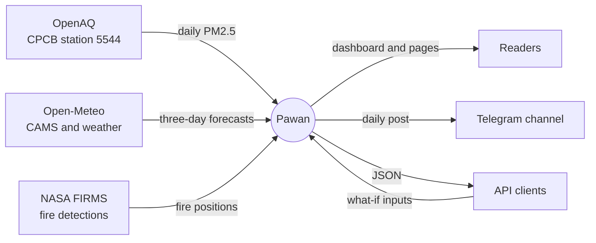
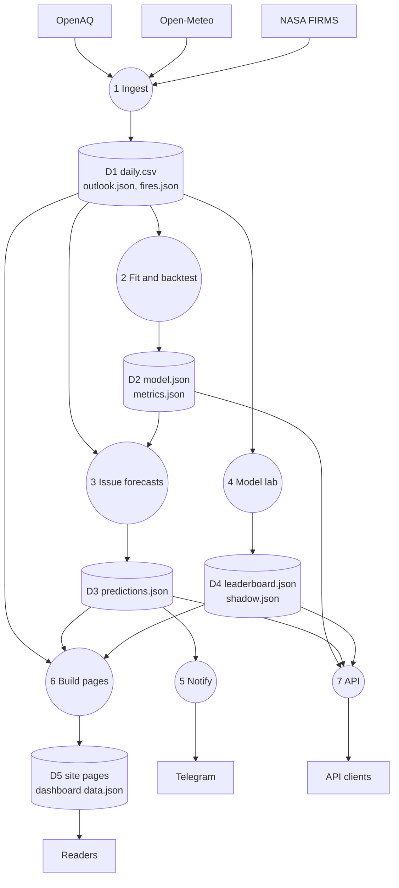
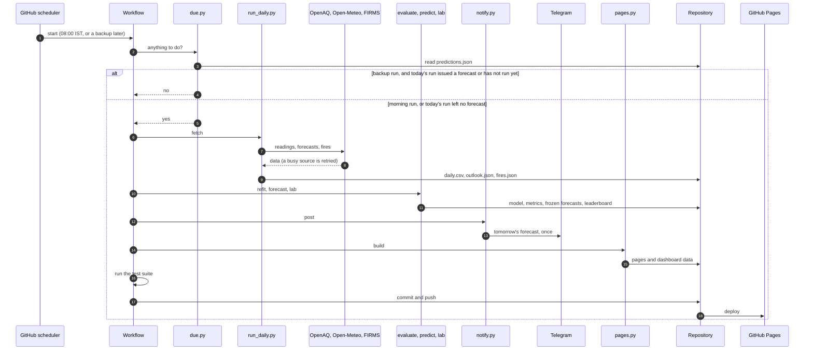
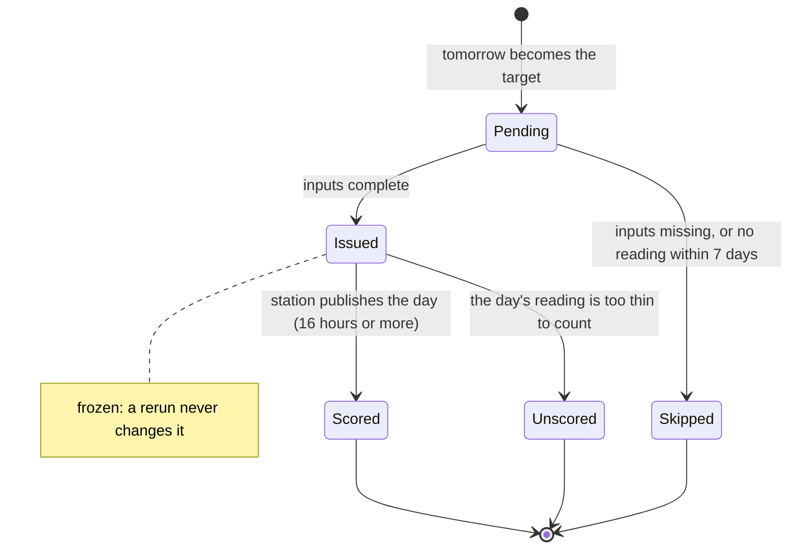
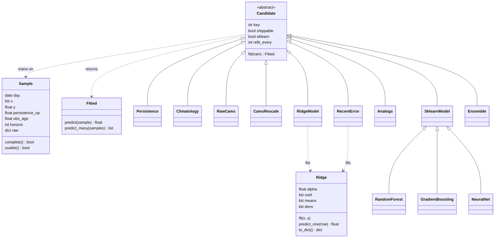
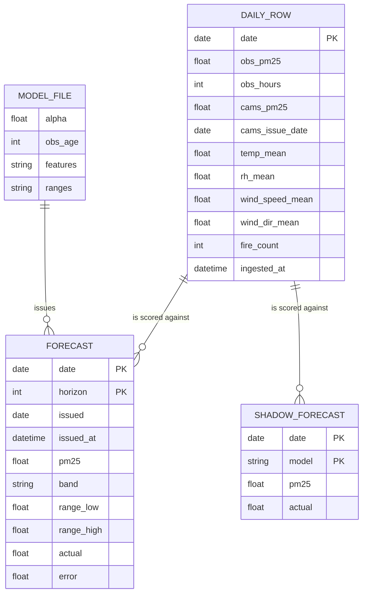
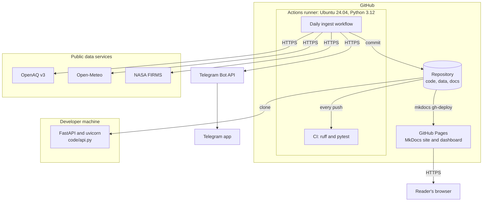

# Design

How Pawan is put together: what it was required to do, the parts
that do it, how data moves between them, and where each requirement
is tested. The diagrams are drawn from the code as it stands; the
numbers that change daily live on [Results](results.md).

## Requirements

### Functional

| ID | The system shall | Where | Status |
| --- | --- | --- | --- |
| FR1 | Collect each day's station reading, the CAMS and weather forecasts, and upwind fire detections | `ingest/run_daily.py` | Met, daily since August 2026 |
| FR2 | Issue a next-day PM2.5 forecast every day without anyone running it | `predict.py`, Daily ingest workflow | Met |
| FR3 | Freeze each forecast when issued, and score it when the station's reading for that day is published | `predict.py` | Met |
| FR4 | Show the forecast, its likely range, what drove it and the track record on a public page | `pages.py`, `docs/dashboard/` | Met |
| FR5 | Compare candidate models on the same days, and keep a live record for each | `candidates.py`, `lab.py` | Met, twelve models |
| FR6 | Forecast two and three days ahead | `predict.py` | Met |
| FR7 | Post each day's forecast to a Telegram channel | `notify.py` | Met; needs the two secrets set |
| FR8 | Serve the forecasts, the leaderboard and a what-if over HTTP | `api.py` | Met, runs locally |
| FR9 | Recover the same day from a failed or late run | `due.py`, `fetch()` retries | Met |

### Non-functional

| ID | Requirement | How it is met | Status |
| --- | --- | --- | --- |
| NFR1 | Accuracy: reduce error against persistence by 10% in calm season and 20% in burning season | Ridge in log space, local readings, fires and weather | Calm met at every reading age. Burning met with the three- and four-day-old readings the target was set for, below it with two-day-old ones |
| NFR2 | Honesty: no forecast or backtest uses data published after its issue time | Fixed reading ages; training cut at the last published day | Met, tested |
| NFR3 | Reliability: one failed step never loses the day's data | Steps that cannot block the commit; backup runs; retries | Met |
| NFR4 | Maintainability: the forecast path cannot break on a dependency upgrade | Forecast is standard library only; extras pinned and optional | Met |
| NFR5 | Security: no key ever reaches the repository or a public log | Secrets in GitHub; URLs redacted before quoting | Met, tested |
| NFR6 | Transparency: every number on the site is regenerated from the data each day | `pages.py` writes the pages from `data/` | Met |
| NFR7 | Usability: the site works on a phone, with no server to keep alive | Static pages; layout checked at 390 px | Met |

## Use cases

Promoting a challenger is deliberately a person's job. The lab says
when a model passes the rule; a maintainer makes the one-line change
in a pull request.

## Context

## Data flow

Processes are numbered in the order the daily job runs them. Every
store is a file in the repository, so its history is the commit log.

## The daily run

Each step after the fetch runs even if an earlier one failed, and
the run only turns red after the commit, so a bad morning still
keeps whatever data it did collect.

## A forecast's life

The forecast is made by a model fitted at exactly the age of the
freshest reading on file, and the age is recorded with it.

## Main classes

`features.build()` turns `daily.csv` into `Sample` rows at a stated
reading age. `evaluate.fit()` chooses the ridge penalty by
validation on the most recent rows and returns a `Ridge`. The model
lab calls every `Candidate` through the same `fit()`, so all of them
are scored on the same days.

## Data model

`daily.csv` is the only store of observations; every other file is
derived from it and can be rebuilt. [Data](data.md) describes each
column and file.

## Deployment

There is no server to keep running. The pipeline lives on GitHub's
runners, the site is static files, and the API is optional and runs
wherever it is cloned.

## Design decisions

| Decision | Instead of | Why |
| --- | --- | --- |
| CSV committed to git | A database | One file of a few hundred rows; the commit log is a free audit trail of every change to the data |
| Static site, separate optional API | A web app with a server | Nothing to keep alive; the dashboard cannot go down with a server |
| Forecast path in the standard library | scikit-learn throughout | The daily job runs unattended for months; the less it depends on, the less can change underneath it |
| Ridge regression in log space | Trees or a neural network | Beats them on about 500 days of data, in the lab's own comparison; its arithmetic can be shown exactly on the dashboard |
| One model per reading age | One model, whatever the reading's age | A model fitted on two-day-old readings would weigh a five-day-old one wrongly |
| Forecasts frozen when issued | Recomputed as the model improves | The track record is of what was actually claimed |
| A written promotion rule | Shipping whichever model scores best | A model can win one exam by luck; the rule asks for several |

## Testing

All tests run on every pull request and every data commit. The
table maps each test file to the requirements it protects.

| Test file | Tests | Covers |
| --- | ---: | --- |
| `test_pages.py` | 32 | FR4, NFR6: pages, dashboard data, the breakdown matching the forecast |
| `test_ingest.py` | 29 | FR1, FR9, NFR5: parsing, wind averaging, retries, key redaction |
| `test_features.py` | 27 | NFR2: reading ages, thin days, the fire lag |
| `test_model.py` | 20 | FR3, NFR2: ridge, the backtest's training cut, the likely range |
| `test_lab.py` | 21 | FR5: fair walk-forward, the promotion rule, shadow forecasts |
| `test_history.py` | 18 | FR1: the one-off history extension |
| `test_predict.py` | 16 | FR2, FR3, FR6: freezing, scoring, the outlook |
| `test_notify.py` | 13 | FR7, NFR5: the post, posting once, the token never printed |
| `test_api.py` | 12 | FR8: every endpoint, what-if parity, input checks |
| `test_schema.py` | 7 | NFR2, NFR5: the data file's columns, no keys in the code, no future data in training rows |
| `test_due.py` | 8 | FR9: when a backup run works and when it stands down |
| **Total** | **203** | |

Beyond unit tests, the walk-forward backtest is the system test of
the forecast: it replays every day since April 2025 with only what
was known at the time. The live record, scored daily, is the
acceptance test.
